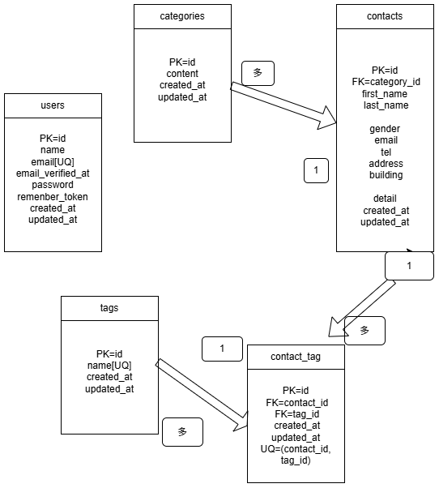

# COACHTECH お問い合わせフォーム

Laravelを使用して作成したお問い合わせ管理システムです。

一般ユーザーがお問い合わせを送信でき、
管理者はログイン後にお問い合わせの一覧表示や検索ができます。

## ER図



## 使用技術

- PHP 8.2
- Laravel 10
- MySQL 8
- Docker / Laravel Sail
- Vite / Tailwind CSS
- Laravel Fortify（ユーザー認証）

## 開発環境URL

http://localhost

## 環境構築手順

### 1. リポジトリをクローン

```bash
git clone https://github.com/a-wakita/contact-form-app.git
cd contact-form-app
```

### 2. Composerのパッケージをインストール

```bash
docker run --rm \
  -u "$(id -u):$(id -g)" \
  -v "$(pwd):/var/www/html" \
  -w /var/www/html \
  laravelsail/php82-composer:latest \
  composer install --ignore-platform-reqs
```

### 3. 環境設定ファイルを作成

```bash
cp .env.example .env
```

`.env` のデータベース設定を確認します。

```env
DB_CONNECTION=mysql
DB_HOST=mysql
DB_PORT=3306
DB_DATABASE=laravel
DB_USERNAME=sail
DB_PASSWORD=password
```

### 4. Dockerコンテナを起動

```bash
./vendor/bin/sail up -d
```

### 5. アプリケーションキーを生成

```bash
./vendor/bin/sail artisan key:generate
```

### 6. データベースを作成し、初期データを投入

```bash
./vendor/bin/sail artisan migrate --seed
```

### 7. フロントエンドの準備

```bash
./vendor/bin/sail npm install
./vendor/bin/sail npm run dev
```

`npm run dev` を実行したターミナルは、開発中は起動したままにします。

### 8. ブラウザでアクセス

http://localhost

## 機能一覧

### 実装済みの機能

- お問い合わせフォームの入力
- お問い合わせ内容の確認・送信
- 送信完了画面の表示
- ユーザー登録・ログイン・ログアウト
- 管理画面でのお問い合わせ一覧表示
- ページネーション（1ページ7件）
- 名前・メールアドレス・性別・お問い合わせ種類・日付による検索
- 複数条件を組み合わせた検索

### 今後実装する機能

- お問い合わせ詳細表示・削除
- タグの追加・編集・削除
- CSVエクスポート
- お問い合わせAPI
- PHPUnitによる自動テスト

## テスト実行方法

```bash
./vendor/bin/sail artisan test
```

カバレッジを確認する場合：

```bash
./vendor/bin/sail artisan test --coverage
```

※カバレッジの確認にはXdebugの設定が必要です。

## 作成者

GitHub: [a-wakita](https://github.com/a-wakita)
